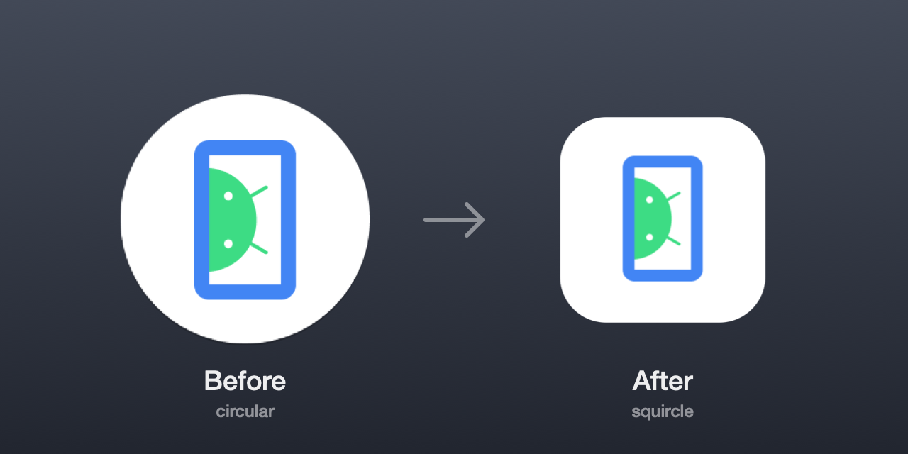

# android-emu-squircle-icon

**Give the Android Emulator a proper macOS icon.**

<p align="center">
  
</p>

> The image is a rendered comparison of the real icon files, not a screenshot of the Dock.

## Why this exists

Every app in the macOS Dock is a rounded square, except the Android Emulator.
It shows up as a flat white **circle**, an icon shape that comes from Android,
not from macOS, sitting in the middle of a row of squircles. If you run several
emulators all day, it is the one icon that looks wrong.

You cannot just swap a `.icns`. The emulator is not an `.app` bundle: it runs as
a bare `qemu-system-*` executable, and Qt sets its icon at runtime from PNG
images compiled into that binary. Changing the icon means editing a signed
binary, and then every SDK or emulator update puts the circle back.

`emu-icon` does that edit safely and repeatably, so you can re-apply it in one
command whenever the SDK updates.

## Compatibility

| | |
|---|---|
| OS | **macOS only.** The script exits with an error on any other platform. |
| Apple Silicon | Supported and tested (emulator 37.2.13, `darwin-aarch64`). |
| Intel | Handled in code (`darwin-x86_64`), **not tested**. |
| Requirements | Xcode Command Line Tools (`swiftc`, `codesign`) and the system `/usr/bin/python3`. Install the tools with `xcode-select --install`. |
| SDK location | `$ANDROID_HOME`, then `$ANDROID_SDK_ROOT`, then `~/Library/Android/sdk`. |

No third-party dependencies: the renderer is Swift/CoreGraphics and the PNG
encoder is plain Python.

## Install

Clone it anywhere. The tool locates its own files, so the folder can live
wherever you like (a hidden folder in `$HOME` works well):

```sh
git clone https://github.com/mrcsxsiq/android-emu-squircle-icon.git ~/.android-emu-squircle-icon
```

Optional: put the command on your `PATH`.

```sh
ln -s ~/.android-emu-squircle-icon/bin/emu-icon /usr/local/bin/emu-icon
# or an alias in ~/.zshrc:
alias emu-icon="$HOME/.android-emu-squircle-icon/bin/emu-icon"
```

## Usage

```sh
emu-icon status           # is the squircle applied? where is the binary?
emu-icon apply            # patch the icon (safe to run repeatedly)
emu-icon apply --force    # re-render and patch even if already applied
emu-icon restore          # put back the most recent pristine backup
```

After `apply`, **restart any running emulator**. If the Dock still shows the old
icon, run `killall Dock`.

### After an SDK or emulator update

Updates replace the binary, which brings the circle back:

```sh
emu-icon status    # "original (circular) icon"?
emu-icon apply
```

## How it works

1. **Find the binary**: `<sdk>/emulator/qemu/darwin-<arch>/qemu-system-<arch>`.
2. **Find the icons**: scan the binary for the three consecutive square PNGs
   (32, 128 and 256 px) that the emulator embeds. Offsets are discovered, not
   hardcoded, so the tool survives version changes.
3. **Render**: draw a white rounded square using Apple's icon template (body is
   824/1024 of the canvas, corner radius about 22.4% of the body) and place the
   original artwork inside it. CoreGraphics does the drawing
   ([`lib/round.swift`](lib/round.swift)).
4. **Encode**: write a minimal PNG, no metadata, best filter per row, maximum
   zlib compression ([`lib/encode.py`](lib/encode.py)).
5. **Patch in place, same length**: the binary addresses resources by offset, so
   each replacement is padded to the exact byte length of the PNG it replaces
   with an ancillary `tEXt` chunk. That chunk also carries a marker used to
   detect an already-patched binary.
6. **Re-sign and swap**: the edit breaks Google's signature, and macOS will not
   run a binary with a broken one. The tool signs ad hoc with the hardened
   runtime, **keeping the original entitlements** (JIT, hypervisor, ...),
   verifies, and atomically replaces the file. Running emulators keep the old
   file and are not disturbed.

The full reasoning is documented in [`lib/patch.py`](lib/patch.py).

## Safety

- The pristine binary is copied to `backups/` before the first patch (the last 3
  are kept, about 60 MB each).
- Nothing is replaced until the new binary is written, signed and verified.
- If the icon layout is not recognised, or a replacement does not fit, the tool
  stops and **does not modify the SDK**.
- Only the icon bytes change. The emulator code is untouched.

## Troubleshooting

| Message / symptom | What to do |
|---|---|
| `emulator binary not found` | Set `ANDROID_HOME` to your SDK path. |
| `could not find the 32/128/256 icon PNGs` | The emulator changed how it embeds the icon. Nothing was modified. Please open an issue. |
| `icon does not fit its slot` | A new binary has smaller slots than the rendered PNG. Nothing was modified. |
| `swiftc: command not found` | Run `xcode-select --install`. |
| Emulator will not start after patching | `emu-icon restore`, then open an issue. |
| Old icon still in the Dock | Restart the emulator, then `killall Dock`. |

`restore` copies the newest backup, which is the binary from just before the
last patch. After an SDK update that is the new version, so restoring never
downgrades the emulator, but it does not undo an SDK update either.

## Layout

```
bin/emu-icon          entry point (runs lib/patch.py with python3 -I)
lib/patch.py          find icons, render, patch, sign, restore
lib/round.swift       squircle renderer (compiled on first run to lib/round)
lib/encode.py         minimal PNG encoder
assets/orig*.png      original circular icons (32/128/256), used as artwork source
docs/                 README preview and the script that regenerates it
backups/              pristine binaries (created on first apply, git-ignored)
```

Regenerate the README image with `docs/make-preview.sh`.

## Disclaimer

This is an unofficial tweak. It modifies a binary distributed by Google and
re-signs it locally with an ad hoc signature, which is only valid on your
machine. Use at your own risk; `emu-icon restore` undoes it.

The Android robot is reproduced from work created and shared by Google and used
according to terms described in the Creative Commons 3.0 Attribution License.
Android is a trademark of Google LLC. This project is not affiliated with or
endorsed by Google.

## License

[MIT](LICENSE) for the code in this repository. The icon artwork in `assets/`
comes from the Android Emulator and is not covered by this license.
